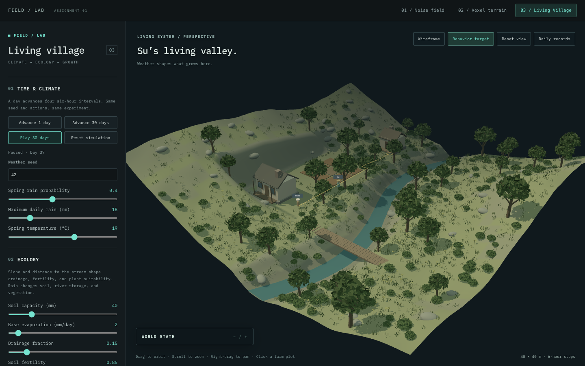
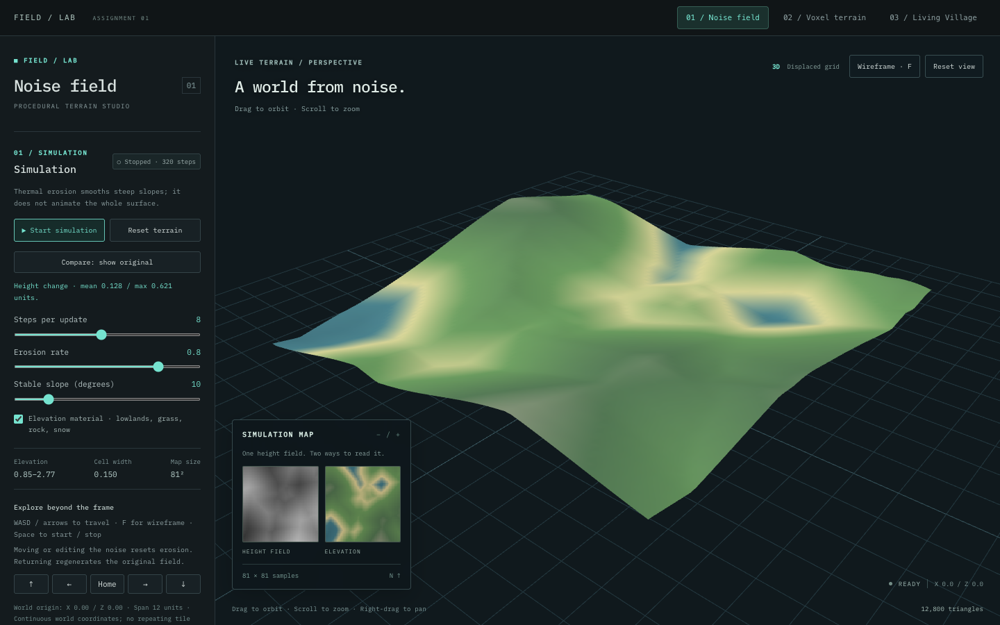
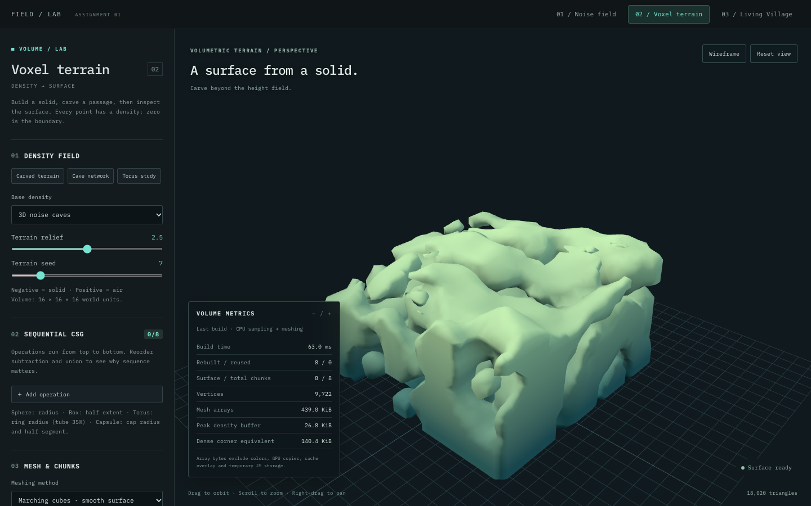
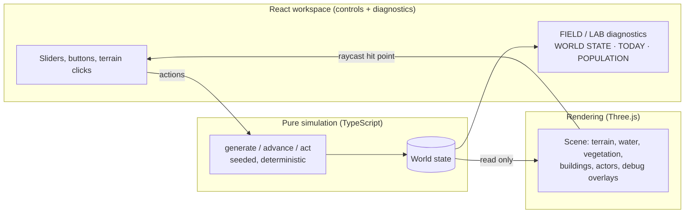
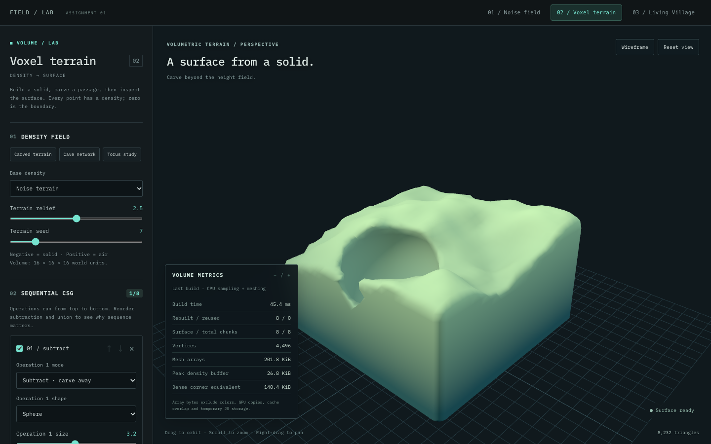
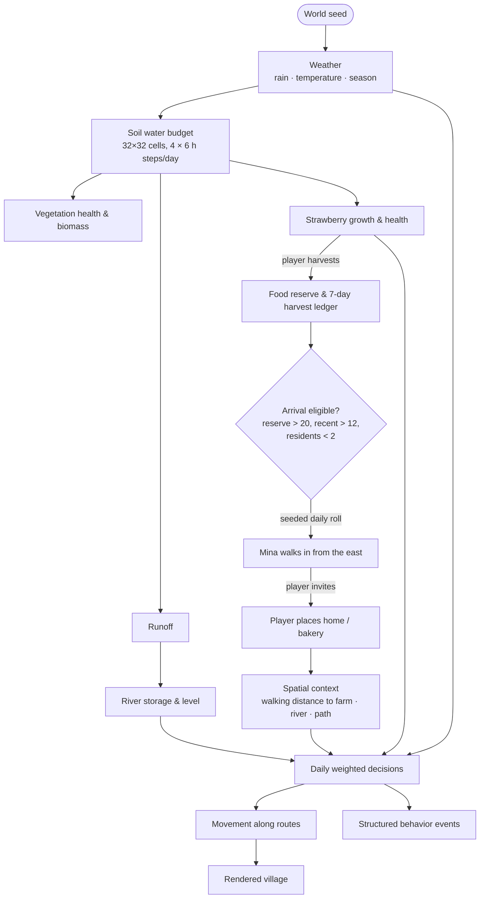
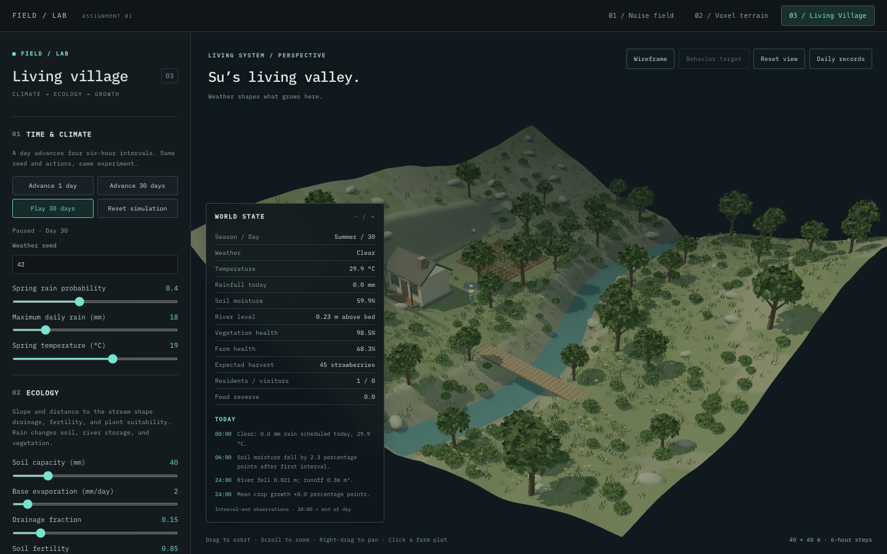
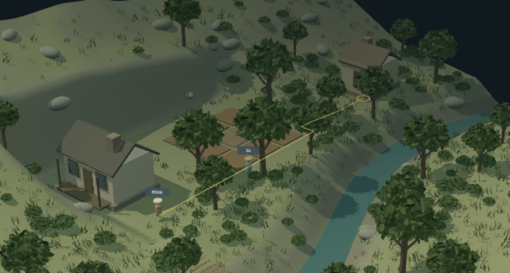
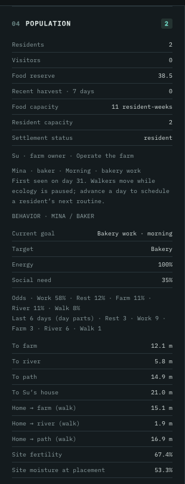

# FIELD / LAB

**A procedural world-building lab in three experiments: terrain from noise, solids from density fields, and a small valley where weather, ecology, food and settlement placement shape how a villager lives.**

Built with React, TypeScript and Three.js. Every system is a pure, seeded rule set that you can inspect while it runs.



---

## Contents

1. [Conceptual premise](#1-conceptual-premise)
2. [The three experiments](#2-the-three-experiments)
3. [System architecture](#3-system-architecture)
4. [01 / Noise Field: geography from noise](#4-01--noise-field-geography-from-noise)
5. [02 / Voxel Terrain: surfaces from solids](#5-02--voxel-terrain-surfaces-from-solids)
6. [03 / Living Village: ecology, population, behavior](#6-03--living-village-ecology-population-behavior)
7. [Design strategies](#7-design-strategies)
8. [AI-assisted development](#8-ai-assisted-development)
9. [Running locally](#9-running-locally)
10. [Repository structure](#10-repository-structure)
11. [Credits, references and tools](#11-credits-references-and-tools)

---

## 1. Conceptual premise

FIELD / LAB treats a synthetic world as a **chain of causes**, not a painted backdrop. Each layer is generated from rules and feeds the next:

```text
NOISE → TERRAIN → WATER & SOIL → VEGETATION & CROPS → FOOD → POPULATION → PLACEMENT → BEHAVIOR → (memory → narrative, future)
```

The first two experiments study how *form* comes from mathematics: a height field from layered noise, and a volume from signed density functions. The third experiment, **Living Village**, asks what happens once that form becomes a place people inhabit. The village is a 40 × 40 m river valley with Su, a farmer. Weather changes the soil, the soil grows crops, and harvests become a food reserve. A surplus can attract a traveler, Mina. The player decides where she builds her home and bakery, and that decision changes her days.

The player never scripts what happens. **The player changes the conditions of the world, and the conditions change the probabilities.** The same seed and the same actions always reproduce the same history. Different placements, weather or harvest choices produce different histories.

## 2. The three experiments

| | Experiment | Question | Core techniques |
|---|---|---|---|
| 01 | **Noise Field**: *A world from noise* | How does layered noise become believable land, and how does land change over time? | Value-noise fBm, ridged and domain-warped noise, resolution-aware octave limiting, height shaping, thermal erosion |
| 02 | **Voxel Terrain**: *A surface from a solid* | How do you model terrain that a height field can't express, such as caves and overhangs? | Signed distance functions, sequential CSG, marching cubes, block meshing, chunk caching |
| 03 | **Living Village**: *A world that grows and remembers* | How do environment, resources and spatial decisions produce inhabitants' behavior? | Seeded weather, cellular water/soil budgets, suitability-based scattering, resource-driven arrival, grid route search, weighted utility decisions |

| 01 / Noise Field | 02 / Voxel Terrain (cave network) |
|---|---|
|  |  |

## 3. System architecture

Each experiment follows the same pattern. **Simulation and generation are plain TypeScript functions** that take state and return new state, with no React, Three.js, timers or `Math.random()`. React owns the state and the controls. **Three.js only reads state and draws it.**



This separation is what makes the systems testable (54 Jest tests run without WebGL) and reproducible. Rendering can never change an outcome.

## 4. 01 / Noise Field: geography from noise

A height field is sampled on an `(n+1)²` grid and displayed both as a 3D mesh and as a 2D map. Up to several **noise layers** are blended by weight, and each layer has its own equation, frequency, octaves, persistence, lacunarity and seed.

**Noise equations** (`src/utils/noise.ts`):

| Equation | Idea |
|---|---|
| Value fBm | Hash values at integer lattice points, smoothstep-interpolate (`t²(3−2t)`), then sum octaves of rising frequency and falling amplitude. |
| Ridged | Each octave contributes `1 − |n|`, which turns zero crossings into sharp crests. |
| Domain warp | Offset the sample coordinates by three other fBm fields before sampling: `fbm(p + 0.8 · fbm₃(p))`. This produces swirled, eroded-looking forms. |

```text
fbm(p):  value = 0, amplitude = 1, frequency = 1
         repeat octaves:
             value     += amplitude * (2 * valueNoise(p * frequency) - 1)
             amplitude *= persistence
             frequency *= lacunarity
         return value / sum(amplitudes)            // in [-1, 1]
```

**Resolution-aware sampling.** Octaves finer than the grid can show only alias as noise. `sampledOctaves` keeps adding octaves only while the finest feature still covers at least four grid cells, and `sampledFrequency` caps base frequency relative to resolution. Changing the resolution changes the detail, not the landform.

**Shaping.** After blending, height can be reshaped: *power* (`hᵖ`, which deepens valleys), *terrace* (blend toward `round(h·6)/6`), or *island* (fade with radial distance).

**Thermal erosion** (`src/experiments/01-noise-field/simulation.ts`) is a conservative talus relaxation:

```text
threshold = tan(stableSlope) * cellSize / heightScale
for each cell i:
    excess[j] = max(0, h[i] - h[j] - threshold)   for the 4 neighbours j
    move  = max(excess) * rate * 0.25            // limited to avoid overshoot
    h[i] -= move;   h[j] += move * excess[j] / sum(excess)
```

Material only moves downhill and the total mass stays the same. The **Compare** toggle shows the original next to the eroded field, and the panel reports mean and maximum height change.

## 5. 02 / Voxel Terrain: surfaces from solids



Every point has a **density** `d(x, y, z)`: negative is solid, positive is air, and the surface is `d = 0`. Unlike a height field, this can represent caves and overhangs.

* **Base fields:** noise terrain `y − amplitude · fbm(x, z)`, 3D caves (terrain minus a thin band around a 3D noise zero set), or an analytic primitive.
* **Primitives** are signed distance functions: sphere, box, torus and capsule.
* **Sequential CSG** is a left fold over an editable stack: `union = min(a, b)`, `subtract = max(a, −b)`, `intersect = max(a, b)`. Order matters, because `(A − B) ∪ C` can refill a cavity that `(A ∪ C) − B` cannot.
* **Meshing**, which you can switch between:
  * *Marching cubes.* Each cell's 8 corner signs form an 8-bit mask that selects triangles from a 256-case table. Edge vertices are interpolated at `t = dA / (dA − dB)` and shared through an edge map. Normals come from central-difference gradients.
  * *Block meshing.* The mesher emits only faces between solid and air voxels.
* **Chunks and caching.** The volume is split into chunks, each sampled with a one-cell halo so borders match exactly. Each chunk has a *signature* (the settings plus any CSG operations whose bounds reach it), so editing a small sphere rebuilds only the nearby chunks. Builds yield between chunks to keep the UI responsive.

Equations, measurements and limitations are documented in [docs/VOXEL_NOTES.md](docs/VOXEL_NOTES.md).

## 6. 03 / Living Village: ecology, population, behavior

### 6.1 The causal chain



| Valley at day 30 (before any arrival) | Mina's route to her target (diagnostic overlay) |
|---|---|
|  |  |

### 6.2 Geography: a fixed valley, seeded details

`landscape.ts` builds the terrain from a deliberately designed valley plus noise:

* A meandering stream centerline, `riverX(z) = 2 + 3 sin(0.15 z)`, and a graded riverbed.
* Rolling ground rises with distance from the stream (`0.7 + (d/12)^1.6 · 2.5`) and gets value-noise relief. A smooth bank blends it into the bed.
* A flat terrace is blended in for Su's farm.
* The terrain is sampled into **32 × 32 ecological cells**, each with elevation, slope, distance to water, `drainage = 0.6 + 1.5 · slope` and `fertility = clamp(0.95 − 0.3 · slope − 0.012 · waterDistance)`.

**Vegetation scattering** is rejection sampling with ecological suitability. 7,500 seeded candidate points are drawn. Points inside excluded zones (farm, house, paths, channel) are discarded. Each remaining point picks a kind (tree, rock, shrub, flower or grass) from local slope, fertility and moisture. It survives with probability ∝ `fertility × moisture × (1 − slope/1.1)`. Trees also need to be more than 2.8 m from other trees and away from the water. Plants are placed once. After that, ecology changes their health and color, not their positions.

### 6.3 Ecology: daily water and growth

`advanceDay` (`simulation.ts`) runs **four six-hour intervals**. Each interval does three things:

1. **Soil bucket model per cell:** add rain, overflow above capacity, evaporate (scaled by temperature), drain (scaled by slope), then subtract plant uptake.
2. **Vegetation:** suitability depends on moisture, temperature and fertility. Health rises when conditions suit the plant and falls when they don't. Biomass follows health.
3. **River reservoir:** overflow and drainage become runoff into one channel store. Discharge is 2.5% plus any overflow above 140 m³, and `riverLevel = storage / 100`.

Strawberry plots run the same soil model and grow by `waterSuitability × temperatureSuitability × seasonSuitability × fertility × health`. Accumulated stress lowers the final yield. Seasons are 28 days long and change temperature and rain probability.

The TODAY log records *measured* changes ("Soil moisture fell by 1.1 percentage points…"), not generated prose. Daily snapshots of every plot can be exported as CSV.

### 6.4 Population: resource-driven arrival and placement

Only harvested food counts, not crops still growing in the field. Residents eat 0.5 units of food per day.

```text
each day:
    if no Mina and reserve > 20 and harvest(last 7 days) > 12 and residents < 2:
        p = min(0.8, 0.35 + 0.005 * (reserve - 20))
        if arrivalRNG() < p: Mina appears at the eastern path and walks to Su's door
```

When Mina arrives, the player can **invite** her, then click the terrain to place her home and bakery. The click becomes a raycast hit, then world X/Z, then pure validation. The site must be inside the valley, on gentle slope and level enough, on dry land, clear of the farm, house and paths, and its door must have a walkable route. **Routes** come from a breadth-first search on a 40 × 40 walkability grid that excludes water, steep ground, farm beds and buildings, with a footbridge across the stream.

When she settles, the simulation stores her **spatial context**. This includes straight-line and *routed walking* distances to the farm, the nearest reachable riverbank and the nearest reachable path, plus local fertility, moisture, elevation and slope. It also stores five named destinations: home, bakery, farm, river and path.

### 6.5 Behavior: placement → tendency → pattern

Mina has no timetable. Each day she makes **four decisions**, one each for morning, midday, afternoon and evening. Each decision chooses among `REST`, `WORK`, `VISIT_FARM`, `VISIT_RIVER`, `WALK` and `RETURN_HOME`, using weights built from five factors:

```text
weight(goal) = base(goal)
             × time(dayPart, goal)                    // e.g. work favoured in the morning, home in the evening
             × needs(energy, socialNeed)              // tired → rest; lonely → visit Su's farm
             × space(walking distance to the goal)    // 0.15 + 1.35 × proximity
             × environment(rain, temperature, river level, ripe crops / recent harvest)

proximity = 1 − clamp(walkingDistance / 30 m, 0, 1)
```

```text
planDay(world):
    energy     = min(1, energy + 0.45)                // overnight rest
    atHome     = true
    for i, part in [morning, midday, afternoon, evening]:
        weights = goalWeights(part, energy, socialNeed, atHome, spatialContext, weather, river, farm)
        roll    = hash(worldSeed, day, "mina", i)      // deterministic in [0, 1)
        goal    = weightedChoice(weights, roll)
        energy     -= cost(goal) + 0.004 * walkingDistance(goal)
        socialNeed  = goal == VISIT_FARM ? socialNeed - 0.45 : socialNeed + 0.08
        atHome      = goal targets home or bakery
    if the evening target is not home: append "Night · return home"
    emit structured events; movement then walks the itinerary
```

**Environment rules stay subtle.** Rain multiplies outdoor goals by `1 − 0.6 · wet` and home goals by `1 + 0.4 · wet`. Comfortable dry weather makes walks more likely. A river above 0.8 m makes river visits less likely. Ripe crops or a recent harvest draw her to the farm. Needs stay within 0–1.

**Observed results** (seed 42, 60 days = 240 decisions per placement, same random rolls for each):

| Home site | Walk to farm / river / path | Farm visits | River visits | Walks | Outings per day, dry / rainy |
|---|---|---|---|---|---|
| Beside the farm | 8 / 6 / 2 m | **38** | 21 | 39 | 1.83 / 0.83 |
| East riverbank | 32 / 1 / 11 m | 11 | **34** | 31 | 1.46 / 0.50 |
| Remote south-east | 44 / 7 / 44 m | 10 | 39 | **6** | **1.06** / 0.33 |

Living beside the farm roughly triples farm visits. A remote home cuts walks and total outings, and rain roughly halves outdoor activity everywhere. Each placement also produces a pattern you can see in the needs: a home far from the farm leaves Mina's social need high, because the need pulls her toward Su while the distance pushes back.



**Events for future memory.** Meaningful transitions become structured `WorldEvent`s, such as `{ type: 'behavior', action: 'VISITED_FARM', actorId: 'mina', targetId: 'su', location: 'farm', context: { part, rainfallMm, riverLevel, energy, socialNeed } }`, with a short template sentence such as *"Mina visited Su's farm in the afternoon."* Consecutive parts at the same place merge into one event, and a day without outings becomes a single `STAYED_HOME`. A planned memory phase can later interpret these raw events.

**Diagnostic overlay.** The **Behavior target** toolbar button draws Mina's remaining route and a ring on her target. It's for inspection, not decoration, so it's off by default.

### 6.6 Try it

1. Open **03 / Living Village** and click **Advance 30 days**, then **Harvest ripe plots**.
2. Click **Advance 30 days** again. Advancing stops on the day Mina arrives. Wait for her to walk to Su's farmhouse.
3. Click **INVITE TO STAY**, then click open, gently sloping ground to place her home.
4. Click **Advance 1 day** and toggle **Behavior target**. To compare placements, click **Reset simulation** and place her somewhere else.

Phase-by-phase design notes are in [docs/planning/](docs/planning/): [overall plan](docs/planning/LIVING_VILLAGE_PLAN.md), [Phase 1: farm](docs/planning/PHASE1_FARM.md), [ecological valley](docs/planning/ECOLOGICAL_VALLEY.md), [Phase 2: population](docs/planning/PHASE2_POPULATION.md) and [Phase 3: behavior](docs/planning/PHASE3_BEHAVIOR.md).

## 7. Design strategies

* **Determinism by construction.** Every random decision comes from an explicit seeded stream, and the streams are independent:

  | Stream | Generator | Used for |
  |---|---|---|
  | Landscape | LCG (`1664525 · s + 1013904223`) from the seed | Vegetation candidates |
  | Weather | Separate LCG state in `WorldState` | Daily rain and temperature |
  | Arrival | Separate LCG, drawn only on eligible days | Mina's arrival roll |
  | Behavior | Stateless hash of `(seed, day, villagerId, decisionIndex)` | Each day-part decision |

  So adding behavior never changes the weather, and fast-forwarding gives the same history as watching playback.
* **Simulation and rendering are separate.** Three.js never decides anything. Rules live in a handful of plain modules with their constants grouped in editable rule objects (`defaultParameters`, `populationRules`, `behaviorRules`).
* **Continuous causes, not zones.** Placement effects come from continuous walking distances, so there are no hard-coded "near farm" or "near river" zones. A new site produces new behavior without new rules.
* **Inspectable systems.** The FIELD / LAB interface is a lab notebook, not a game HUD. It shows measured world state, a daily log, odds and tallies, so you can trace the reason behind each change.
* **Small, scoped phases.** Each phase adds one link to the chain (farm → population → behavior) and comes with its own tests and design note. Larger features (relationships, memory, narrative, more villagers) are deliberately deferred.

## 8. AI-assisted development

AI coding assistants were part of the workflow. The author kept control of the concept, the scope and the decisions; the assistants worked through written briefs. The process was:

1. **Brief.** The author writes a phase brief: the premise, the causal chain to add, explicit *do-not-build* limits, success criteria and required tests. The planning notes in `docs/planning/` came out of this process.
2. **Inspect, then report.** The assistant first reads the current code and reports where state lives, what can be extended and which files will change, before it edits anything.
3. **Implement in small steps.** The simulation comes first as pure functions, then the UI and rendering, in small commits.
4. **Verify.** The full Jest suite and the production build run after each step. The assistant then checks the running app in a headless browser (screenshots, console errors) and measures behavioral outcomes, such as the placement table above. The measurements were used to calibrate constants; for example, the proximity scale was tightened from 40 m to 30 m after the first measurements showed the placement effect was too weak.
5. **Review.** The author reviews the behavior in the app and steers the next phase.

Phase 3 (spatial behavior) and this documentation were produced with **Claude Code (Anthropic)**, and those commits carry a `Co-Authored-By: Claude` trailer. AI assistance was most useful for keeping the architecture consistent across modules, writing tests alongside the rules, and measuring emergent behavior. The design decisions are the author's: what the world is *about*, which causes matter, and what to leave out.

## 9. Running locally

Requirements: **Node.js 18+** and npm. No accounts, API keys or environment variables are needed.

```bash
git clone https://github.com/SophieSu2723/design4197.git
cd design4197
npm install
npm start
```

Open <http://localhost:3000> and switch experiments using the tabs at the top. State is kept in memory: switching tabs keeps the village, but refreshing the page starts a new world.

```bash
CI=true npm test -- --watchAll=false --runInBand   # 54 tests: noise, erosion, voxels, ecology, population, behavior, UI
npm run build                                      # production build in build/
npm run benchmark:voxel                            # optional voxel meshing benchmark
```

The 3D views need WebGL. If WebGL isn't available, the diagnostics and controls still work.

## 10. Repository structure

```text
src/
├── App.tsx                         # Top navigation; owns the village world across tab switches
├── utils/noise.ts                  # Value noise, fBm, ridged, domain-warp
├── components/                     # Shared FIELD / LAB slider and styles
└── experiments/
    ├── 01-noise-field/             # gridNoise.ts (layers, shaping), simulation.ts (thermal erosion), workspace + tests
    ├── 02-voxel-terrain/           # voxel.ts (SDF, CSG, chunks, marching cubes/blocks), marchingTables.ts, view + tests
    └── 03-living-village/
        ├── landscape.ts            # Valley terrain, ecological cells, vegetation scattering
        ├── simulation.ts           # WorldState, weather, soil/vegetation/river/crops, actions, events
        ├── population.ts           # Resources, arrival, routing, movement, invitation, placement, spatial context
        ├── behavior.ts             # Daily weighted decisions, needs, behavior events
        ├── VillageWorkspace.tsx    # Controls and diagnostics
        ├── rendering/              # FarmView (scene, actors, bakery, debug overlay), terrain, water, vegetation
        └── *.test.ts(x)            # Simulation, population, behavior, landscape and UI tests
docs/
├── images/                         # Screenshots used in this README
├── planning/                       # Living Village plan and phase notes
└── VOXEL_NOTES.md                  # Voxel equations, measurements, limitations
scripts/                            # Dev-server launcher, voxel benchmark
```

## 11. Credits, references and tools

**Libraries**

* [React 19](https://react.dev/) and [TypeScript](https://www.typescriptlang.org/), bootstrapped with [Create React App](https://create-react-app.dev/) (`react-scripts` 5)
* [Three.js](https://threejs.org/) 0.184 for rendering, `OrbitControls` and `BufferGeometryUtils`
* [Jest](https://jestjs.io/) and [Testing Library](https://testing-library.com/) for tests

**Code credits**

* The value-noise utility is based on the implementation in [Procedural World Building](https://github.com/jomasan/Procedural-World-Building).
* The marching-cubes lookup table comes from three.js `examples/jsm/objects/MarchingCubes.js` (MIT). Its notice is kept in `src/experiments/02-voxel-terrain/marchingTables.ts`.

**References**

* Ebert, Musgrave, Peachey, Perlin, Worley: *Texturing and Modeling: A Procedural Approach*, on fBm and ridged multifractals.
* Musgrave, Kolb, Mace (1989): "The Synthesis and Rendering of Eroded Fractal Terrains", on thermal erosion.
* Lorensen and Cline (1987): "Marching Cubes: A High Resolution 3D Surface Construction Algorithm"; Paul Bourke, [Polygonising a scalar field](https://paulbourke.net/geometry/polygonise/).
* Inigo Quilez: [distance functions](https://iquilezles.org/articles/distfunctions/) and [domain warping](https://iquilezles.org/articles/warp/).
* Dave Mark: *Behavioral Mathematics for Game AI*, on utility-based weighted decisions.

**Tools**

* Visual Studio Code, Git and GitHub
* Claude Code (Anthropic) for AI-assisted implementation, testing and documentation (see [section 8](#8-ai-assisted-development))
* Headless Google Chrome for browser verification and the screenshots in `docs/images/`
