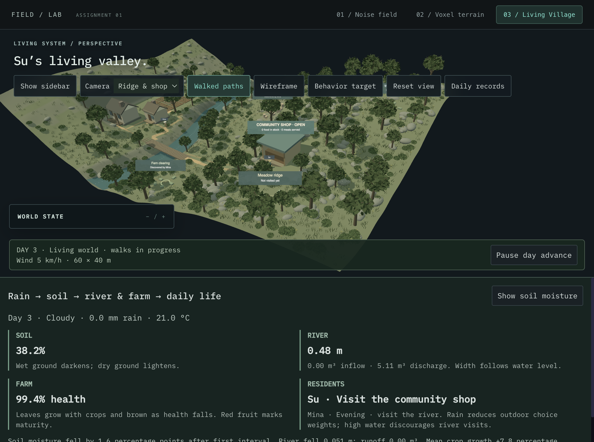
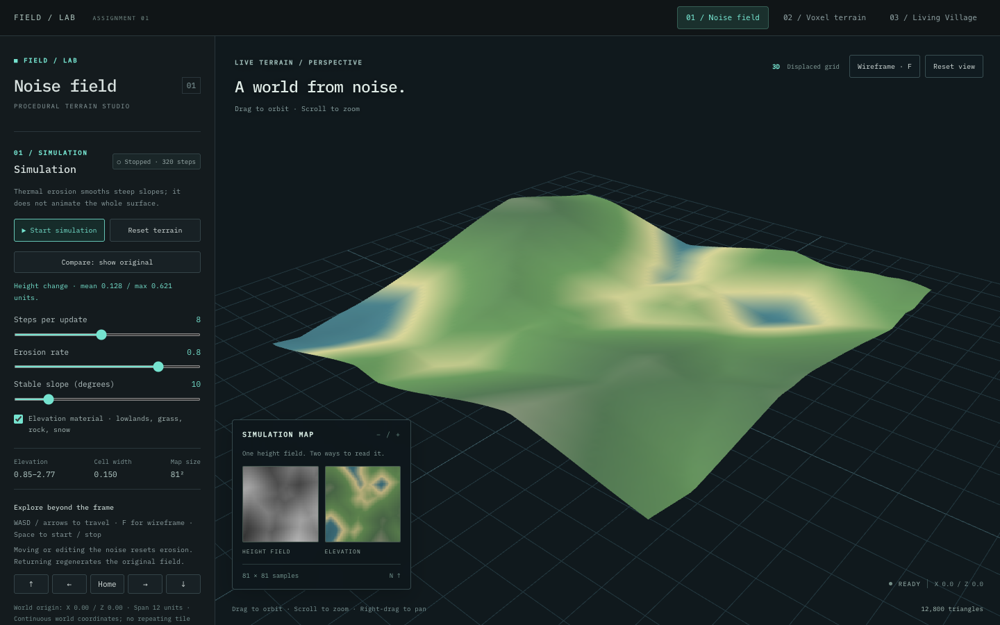
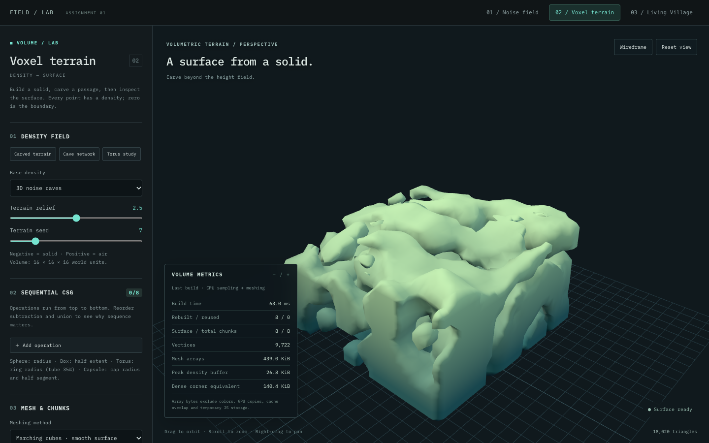
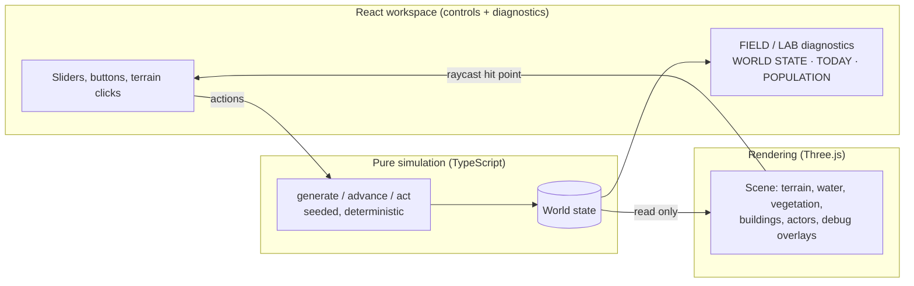
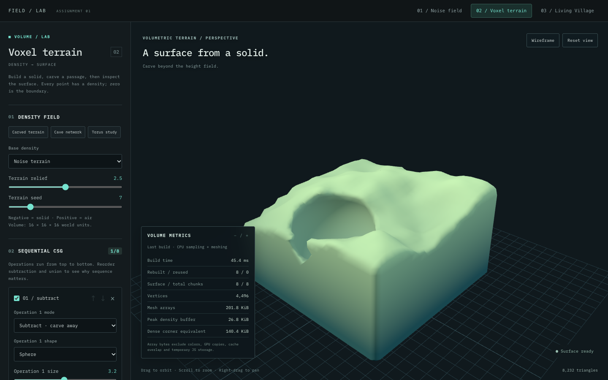
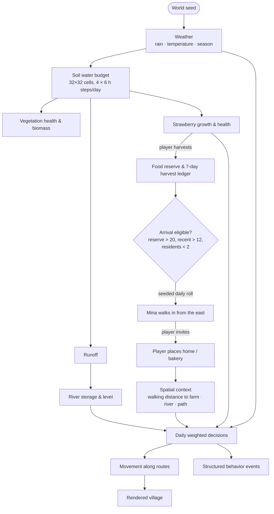
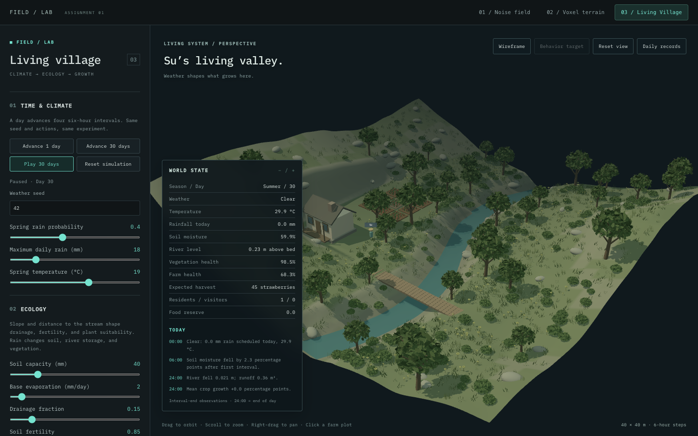
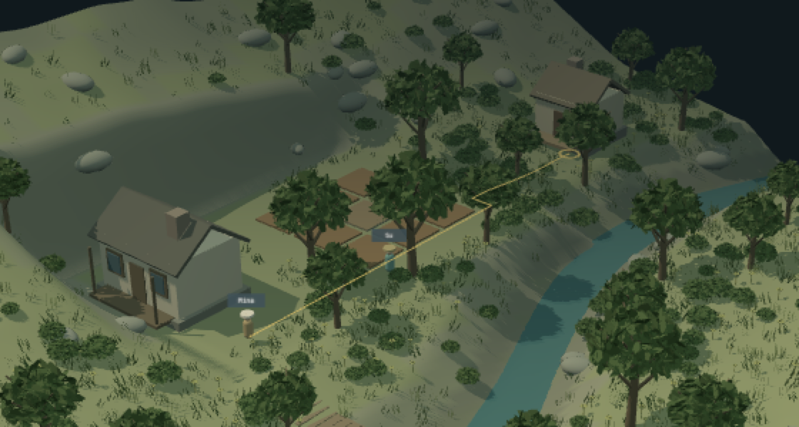
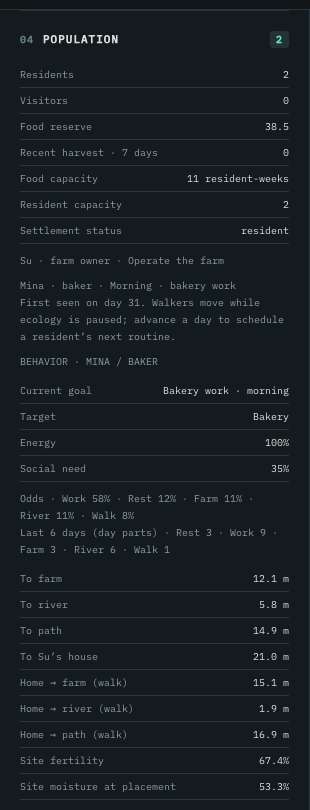

# FIELD / LAB

*A procedural valley about how a place becomes home through weather, distance, work and repeated visits.*

**[Run the project locally](#9-running-locally)** · **[Explore the process](#2-process-and-critique)** · **[Read the phase notes](docs/planning/)**



*A captured run of Living Village. The shop and ridge are later additions to the same world, not separate scenes.*

---

## Contents

1. [Design position and references](#1-design-position-and-references)
2. [Process and critique](#2-process-and-critique)
3. [System architecture](#3-system-architecture)
4. [01 / Noise Field: geography from noise](#4-01--noise-field-geography-from-noise)
5. [02 / Voxel Terrain: surfaces from solids](#5-02--voxel-terrain-surfaces-from-solids)
6. [03 / Living Village: ecology, population, behavior](#6-03--living-village-ecology-population-behavior)
7. [Design strategies](#7-design-strategies)
8. [AI-assisted development](#8-ai-assisted-development)
9. [Running locally](#9-running-locally)
10. [Repository structure](#10-repository-structure)
11. [Credits, references and tools](#11-credits-references-and-tools)

---

## 1. Design position and references

> **When does a landscape become someone's home?** Can weather, access, work and repeated journeys leave enough evidence to answer that question without a scripted story?

I study environment and distance because they make daily life materially different. Rain enters soil; soil affects crops and river storage; food and flooding change whether residents can work, visit or cross the bridge. Mina's house is deliberately placed by the visitor. That choice is the experiment: under the same seed, a home beside Su's farm and a home across the river create different route lengths and therefore different chances of meeting, walking and returning. The simulation decides the routines; the visitor sets their conditions.

This project brings the class's procedural studies toward one inhabited world. The noise field informs its terrain; the voxel study remains an independent investigation of caves and solids. The authored valley and landmarks give the village a readable frame; seeded terrain detail, vegetation, weather, ecological state, routes and daily choices vary within it. The village's rule chain is:

```text
noise → terrain → rain → soil → river / crops / vegetation → food and access
                                                      ↓
             home placement → walking distance → daily decisions → completed journeys
                                                                  ↓
                                        familiarity, worn paths, construction and repair
                                                                  ↺ future decisions
```

Two references guide different parts of this question. They are precedents, not specifications:

| Reference | What I take | What I change in this project |
|---|---|---|
| [*Stardew Valley*](https://www.stardewvalley.net/about/) | Farming, seasons, a town with recurring everyday destinations, and the sense that routines make a place familiar. | There is no quest or fixed villager schedule. Rain, soil water, harvest, travel distance and needs change the odds of an outing; an actual arrival, rather than a planned visit, adds familiarity. Farming is one way the ecology enters social life, not the whole subject. |
| [Do Ho Suh's *Rubbing/Loving*](https://art21.org/read/conversation-starter-what-details-make-a-home/) | A way to think about home through the details and traces of inhabiting a space over time. | I translate this idea into a small, inspectable procedural rule: completed visits build a place record and can bias later choices. The numerical familiarity score is my design device, not a claim that Suh models memory this way. |

**What the visitor can change.** Ecology and storm controls edit the current run: they retain the day, residents, water, memories and past events, and their effects appear on the next simulated day unless the control says otherwise. Opening the eastern ridge adds land while preserving the original valley. A seed change or a named **Start… study** action explicitly begins another run. The large cause-and-effect panel reports measured changes, while the scene shows rain, river level, soil moisture, crop and plant condition, residents' routes and storm damage. Water movement is illustrated by markers; it is not a fluid simulation.

## 2. Process and critique

I developed the project by asking each system to produce a visible consequence for the next one. The phase notes preserve the rules, checks and limits behind these decisions.

| Stage | Question and change | Evidence or lesson |
|---|---|---|
| [01 Noise Field](#4-01--noise-field-geography-from-noise) | Can layered noise make legible geography, and can erosion alter it? | Map/mesh comparison and measured height changes; this became the landform study. |
| [02 Voxel Terrain](#5-02--voxel-terrain-surfaces-from-solids) | What can a density field express that a height field cannot? | Cave and CSG studies with marching-cubes/block-mesh comparison; a separate form experiment, not the village terrain. |
| [03 Ecological valley](docs/planning/ECOLOGICAL_VALLEY.md) and [farm](docs/planning/PHASE1_FARM.md) | Make rain change soil, runoff, river, plant health and crops before adding residents. | Daily water budgets, scene colors/growth and a measured TODAY panel made the relation inspectable. |
| [04 Arrival and placement](docs/planning/PHASE2_POPULATION.md), then [spatial behavior](docs/planning/PHASE3_BEHAVIOR.md) | Could food surplus bring Mina, and could the location of her home affect her routine? | A same-seed, three-site comparison showed large differences in planned farm and walking choices (table below). Manual placement remains because it exposes the design variable. |
| [05 Place memory and exploration](docs/planning/PHASE4_EXPLORATION.md) | What if a place changes future choices only after someone actually reaches it? | Completed arrivals now update familiarity and discovery. Footsteps expose trails and compress nearby grass; unused traces fade. The bridge opens two eastern destinations. |
| [06 Shop, storm and recovery](docs/planning/PHASE5_DEVELOPMENT.md) | What happens to shared daily life when weather breaks access? | The ridge adds land; Su's completed work visits build a shop; storms can close the bridge and damage crops, plants and roofing; later visits repair access. A recorded run is described below. |
| [07 Seed-bank growth](docs/planning/PHASE6_SUCCESSION.md) | Can rain, soil and completed footsteps change where new vegetation appears? | Latent grass and flower sites germinate on suitable ground, then grow or decline over days. The live control and a readable scene panel show gains, losses and their causes. |

**A controlled placement comparison.** In an earlier behavior model, I kept seed 42 and the weather/decision rolls fixed, changed only Mina's home site, and ran 60 days (240 day-part *plans* per site):

| Home site | Walk to farm / river / path | Planned farm choices | Planned river choices | Planned walks | Outdoor outings/day, dry / rainy |
|---|---|---:|---:|---:|---:|
| Beside the farm | 8 / 6 / 2 m | 38 | 21 | 39 | 1.83 / 0.83 |
| East riverbank | 32 / 1 / 11 m | 11 | 34 | 31 | 1.46 / 0.50 |
| Remote south-east | 44 / 7 / 44 m | 10 | 39 | 6 | 1.06 / 0.33 |

These are **historical decision counts, not proof of completed visits**. That was a weakness of the earlier log: it used names such as `VISITED_FARM` for planned actions. The current memory and discovery system counts only actual arrivals. The narrow valley also puts every valid site fairly close to some riverbank, so the placement experiment separates farm access more clearly than river access. See the original [behavior study](docs/planning/PHASE3_BEHAVIOR.md).

**A failed ecology presentation.** An early dry exploration preset made the new paths easy to see, but prolonged playback also stressed crops and vegetation. That image [records the trade-off](docs/images/03-exploration-check.png): a useful controlled path study is not automatically a healthy, balanced village. The preset is a fresh experiment, not a recommended long-term climate.

**A storm observation.** In one prepared seed-42 run, Su framed the shop on day 1 and finished it on day 2. A queued 90 km/h storm on day 5 damaged 466 plant sites and felled 31 trees; Su repaired the bridge on days 6–7 and brought the shop to 81% integrity on day 8. These dates and counts describe that run, not every seed or sequence of actions. The [shop capture](docs/images/04-shop-preview.png) shows an empty store because construction creates no food; the [storm capture](docs/images/04-storm-preview.png) shows cumulative damage after a second storm. Repair needs access and calm weather, so recovery is conditional.

**How to see the present system.** In **03 / Living Village**, choose **Start exploration study** for a reproducible day-zero settlement, then **Open eastern ridge** and **Commission shop**. Use **Play 30 days** or **Run world** to watch completed routes, then **Queue one storm** (around 90 km/h) and advance a day. Compare the bridge, plants, crops, shop and residents before and after; read the cause-and-effect and place-memory panels for why. Adjust rain, soil, wind or curiosity during playback to alter the existing world without erasing its history. To compare house sites, start fresh runs with the same seed, invite Mina and place her home at different valid points.

**What remains unresolved.** The valley has two residents and authored destinations. Its place memory is a simple score, not an account of human emotion or the experience in Suh's work. New grass and flowers establish from precomputed potential sites; unrestricted seed dispersal and ecological competition are not modeled. Fallen trunks do not block paths. The shop stores food but has no prices or broader economy. The storm model is illustrative rather than structural engineering, and a browser refresh does not yet preserve the run. These limits matter when reading the screenshots as evidence.

### The three experiments

| | Experiment | Question | Core techniques |
|---|---|---|---|
| 01 | **Noise Field**: *A world from noise* | How does layered noise become believable land, and how does land change over time? | Value-noise fBm, ridged and domain-warped noise, resolution-aware octave limiting, height shaping, thermal erosion |
| 02 | **Voxel Terrain**: *A surface from a solid* | How do you model terrain that a height field can't express, such as caves and overhangs? | Signed distance functions, sequential CSG, marching cubes, block meshing, chunk caching |
| 03 | **Living Village**: *A world that grows and remembers* | How do environment, resources and spatial decisions produce inhabitants' behavior? | Seeded weather, cellular water/soil budgets, suitability-based scattering, resource-driven arrival, grid route search, weighted utility decisions |

| 01 / Noise Field | 02 / Voxel Terrain (cave network) |
|---|---|
|  |  |

## 3. System architecture

Each experiment follows the same pattern. **Simulation and generation are plain TypeScript functions** that take state and return new state, with no React, Three.js, timers or `Math.random()`. React owns the state and the controls. **Three.js only reads state and draws it.**



This separation is what makes the systems testable (75 Jest tests run without WebGL) and reproducible. Rendering can never change an outcome.

## 4. 01 / Noise Field: geography from noise

A height field is sampled on an `(n+1)²` grid and displayed both as a 3D mesh and as a 2D map. Up to several **noise layers** are blended by weight, and each layer has its own equation, frequency, octaves, persistence, lacunarity and seed.

**Noise equations** (`src/utils/noise.ts`):

| Equation | Idea |
|---|---|
| Value fBm | Hash values at integer lattice points, smoothstep-interpolate (`t²(3−2t)`), then sum octaves of rising frequency and falling amplitude. |
| Ridged | Each octave contributes `1 − |n|`, which turns zero crossings into sharp crests. |
| Domain warp | Offset the sample coordinates by three other fBm fields before sampling: `fbm(p + 0.8 · fbm₃(p))`. This produces swirled, eroded-looking forms. |

```text
fbm(p):  value = 0, amplitude = 1, frequency = 1
         repeat octaves:
             value     += amplitude * (2 * valueNoise(p * frequency) - 1)
             amplitude *= persistence
             frequency *= lacunarity
         return value / sum(amplitudes)            // in [-1, 1]
```

**Resolution-aware sampling.** Octaves finer than the grid can show only alias as noise. `sampledOctaves` keeps adding octaves only while the finest feature still covers at least four grid cells, and `sampledFrequency` caps base frequency relative to resolution. Changing the resolution changes the detail, not the landform.

**Shaping.** After blending, height can be reshaped: *power* (`hᵖ`, which deepens valleys), *terrace* (blend toward `round(h·6)/6`), or *island* (fade with radial distance).

**Thermal erosion** (`src/experiments/01-noise-field/simulation.ts`) is a conservative talus relaxation:

```text
threshold = tan(stableSlope) * cellSize / heightScale
for each cell i:
    excess[j] = max(0, h[i] - h[j] - threshold)   for the 4 neighbours j
    move  = max(excess) * rate * 0.25            // limited to avoid overshoot
    h[i] -= move;   h[j] += move * excess[j] / sum(excess)
```

Material only moves downhill and the total mass stays the same. The **Compare** toggle shows the original next to the eroded field, and the panel reports mean and maximum height change.

## 5. 02 / Voxel Terrain: surfaces from solids



Every point has a **density** `d(x, y, z)`: negative is solid, positive is air, and the surface is `d = 0`. Unlike a height field, this can represent caves and overhangs.

* **Base fields:** noise terrain `y − amplitude · fbm(x, z)`, 3D caves (terrain minus a thin band around a 3D noise zero set), or an analytic primitive.
* **Primitives** are signed distance functions: sphere, box, torus and capsule.
* **Sequential CSG** is a left fold over an editable stack: `union = min(a, b)`, `subtract = max(a, −b)`, `intersect = max(a, b)`. Order matters, because `(A − B) ∪ C` can refill a cavity that `(A ∪ C) − B` cannot.
* **Meshing**, which you can switch between:
  * *Marching cubes.* Each cell's 8 corner signs form an 8-bit mask that selects triangles from a 256-case table. Edge vertices are interpolated at `t = dA / (dA − dB)` and shared through an edge map. Normals come from central-difference gradients.
  * *Block meshing.* The mesher emits only faces between solid and air voxels.
* **Chunks and caching.** The volume is split into chunks, each sampled with a one-cell halo so borders match exactly. Each chunk has a *signature* (the settings plus any CSG operations whose bounds reach it), so editing a small sphere rebuilds only the nearby chunks. Builds yield between chunks to keep the UI responsive.

Equations, measurements and limitations are documented in [docs/VOXEL_NOTES.md](docs/VOXEL_NOTES.md).

## 6. 03 / Living Village: ecology, population, behavior

### 6.1 The causal chain



| Valley at day 30 (before any arrival) | Mina's route to her target (diagnostic overlay) |
|---|---|
|  |  |

### 6.2 Geography: a fixed valley, seeded details

`landscape.ts` builds the terrain from a deliberately designed valley plus noise:

* A meandering stream centerline, `riverX(z) = 2 + 3 sin(0.15 z)`, and a graded riverbed.
* Rolling ground rises with distance from the stream (`0.7 + (d/12)^1.6 · 2.5`) and gets value-noise relief. A smooth bank blends it into the bed.
* A flat terrace is blended in for Su's farm.
* The terrain is sampled into **32 × 32 ecological cells**, each with elevation, slope, distance to water, `drainage = 0.6 + 1.5 · slope` and `fertility = clamp(0.95 − 0.3 · slope − 0.012 · waterDistance)`.

**Vegetation scattering** is rejection sampling with ecological suitability. 7,500 seeded candidate points are drawn. Points inside excluded zones (farm, house, paths, channel) are discarded. Each remaining point picks a kind (tree, rock, shrub, flower or grass) from local slope, fertility and moisture. It survives with probability ∝ `fertility × moisture × (1 − slope/1.1)`. Trees also need to be more than 2.8 m from other trees and away from the water. The original plants are placed once. A separate, initially invisible seed bank lets grass and flowers establish later where soil, weather and footsteps permit; see [Phase 6](docs/planning/PHASE6_SUCCESSION.md).

### 6.3 Ecology: daily water and growth

`advanceDay` (`simulation.ts`) runs **four six-hour intervals**. Each interval does three things:

1. **Soil bucket model per cell:** add rain, overflow above capacity, evaporate (scaled by temperature), drain (scaled by slope), then subtract plant uptake.
2. **Vegetation:** suitability depends on moisture, temperature and fertility. Health rises when conditions suit the plant and falls when they don't. Biomass follows health.
3. **River reservoir:** overflow and drainage become runoff into one channel store. Discharge is 2.5% plus any overflow above 140 m³, and `riverLevel = storage / 100`.

Strawberry plots run the same soil model and grow by `waterSuitability × temperatureSuitability × seasonSuitability × fertility × health`. Accumulated stress lowers the final yield. Seasons are 28 days long and change temperature and rain probability.

The TODAY log records *measured* changes ("Soil moisture fell by 1.1 percentage points…"), not generated prose. Daily snapshots of every plot can be exported as CSV.

### 6.4 Population: resource-driven arrival and placement

Only harvested food counts, not crops still growing in the field. Residents eat 0.5 units of food per day.

```text
each day:
    if no Mina and reserve > 20 and harvest(last 7 days) > 12 and residents < 2:
        p = min(0.8, 0.35 + 0.005 * (reserve - 20))
        if arrivalRNG() < p: Mina appears at the eastern path and walks to Su's door
```

When Mina arrives, the player can **invite** her, then click the terrain to place her home and bakery in the original valley. The click becomes a raycast hit, then world X/Z, then pure validation. The site must be inside the valley, on gentle slope and level enough, on dry land, clear of the farm, house and paths, and its door must have a walkable route. **Routes** come from a breadth-first search on a 40 × 40 walkability grid, extended to 60 × 40 when the ridge opens. Water, steep ground, farm beds and buildings are excluded. Bridge closures and new construction change the navigation topology and invalidate affected cached routes.

When she settles, the simulation stores her **spatial context**. This includes straight-line and *routed walking* distances to the farm, the nearest reachable riverbank and the nearest reachable path, plus local fertility, moisture, elevation and slope. It also stores five named destinations: home, bakery, farm, river and path.

### 6.5 Behavior: placement → tendency → pattern

The original spatial-behavior study gave Mina **four decisions** per day, one each for morning, midday, afternoon and evening. She had no timetable. Each decision chose among `REST`, `WORK`, `VISIT_FARM`, `VISIT_RIVER`, `WALK` and `RETURN_HOME`, using weights built from five factors:

```text
weight(goal) = base(goal)
             × time(dayPart, goal)                    // e.g. work favoured in the morning, home in the evening
             × needs(energy, socialNeed)              // tired → rest; lonely → visit Su's farm
             × space(walking distance to the goal)    // 0.15 + 1.35 × proximity
             × environment(rain, temperature, river level, ripe crops / recent harvest)

proximity = 1 − clamp(walkingDistance / 30 m, 0, 1)
```

```text
planDay(world):
    energy     = min(1, energy + 0.45)                // overnight rest
    atHome     = true
    for i, part in [morning, midday, afternoon, evening]:
        weights = goalWeights(part, energy, socialNeed, atHome, spatialContext, weather, river, farm)
        roll    = hash(worldSeed, day, "mina", i)      // deterministic in [0, 1)
        goal    = weightedChoice(weights, roll)
        energy     -= cost(goal) + 0.004 * walkingDistance(goal)
        socialNeed  = goal == VISIT_FARM ? socialNeed - 0.45 : socialNeed + 0.08
        atHome      = goal targets home or bakery
    if the evening target is not home: append "Night · return home"
    emit structured events; movement then walks the itinerary
```

**Environment rules stay subtle.** Rain multiplies outdoor goals by `1 − 0.6 · wet` and home goals by `1 + 0.4 · wet`. Comfortable dry weather makes walks more likely. A river above 0.8 m makes river visits less likely. Ripe crops or a recent harvest draw her to the farm. Needs stay within 0–1.

**Historical behavior baseline, before exploration and completed-arrival familiarity** (seed 42, 60 days = 240 planned decisions per placement, same random rolls for each). These counts describe that earlier model, not the current expanded choice set:

| Home site | Walk to farm / river / path | Planned farm choices | Planned river choices | Planned walks | Outings per day, dry / rainy |
|---|---|---|---|---|---|
| Beside the farm | 8 / 6 / 2 m | **38** | 21 | 39 | 1.83 / 0.83 |
| East riverbank | 32 / 1 / 11 m | 11 | **34** | 31 | 1.46 / 0.50 |
| Remote south-east | 44 / 7 / 44 m | 10 | 39 | **6** | **1.06** / 0.33 |

In that baseline, living beside the farm roughly tripled farm *choices*. A remote home cut walks and total outings, and rain reduced outdoor activity at every site. A home far from the farm also left Mina's social need high: the need pulled her toward Su while the distance pushed back. The later exploration, shop and familiarity rules add possible destinations and alter these distributions; this table is not a measurement of the current version.



**Plans and completed arrivals.** The legacy behavior log stores planned daily choices, including action names such as `VISITED_FARM`; it does not prove a route was completed. Place memories and the discovery journal are updated separately by actual movement. Consecutive stays at the same destination add no second arrival. Failed routes receive no visit credit.

**Diagnostic overlay.** The **Behavior target** toolbar button draws Mina's remaining route and a ring on her target. It's for inspection, not decoration, so it's off by default.

### 6.6 Try it

1. Open **03 / Living Village** and click **Advance 30 days**, then **Harvest ripe plots**.
2. Click **Advance 30 days** again. Advancing stops on the day Mina arrives. Wait for her to walk to Su's farmhouse.
3. Click **INVITE TO STAY**, then click open, gently sloping ground to place her home.
4. Click **Advance 1 day** and toggle **Behavior target**. To compare placements, click **Reset simulation** and place her somewhere else.

Phase-by-phase design notes are in [docs/planning/](docs/planning/): [overall plan](docs/planning/LIVING_VILLAGE_PLAN.md), [Phase 1: farm](docs/planning/PHASE1_FARM.md), [ecological valley](docs/planning/ECOLOGICAL_VALLEY.md), [Phase 2: population](docs/planning/PHASE2_POPULATION.md) and [Phase 3: behavior](docs/planning/PHASE3_BEHAVIOR.md).

## 7. Design strategies

* **Determinism by construction.** Every random decision comes from an explicit seeded stream, and the streams are independent:

  | Stream | Generator | Used for |
  |---|---|---|
  | Landscape | LCG (`1664525 · s + 1013904223`) from the seed | Vegetation candidates |
  | Weather | Separate LCG state in `WorldState` | Daily rain and temperature |
  | Arrival | Separate LCG, drawn only on eligible days | Mina's arrival roll |
  | Behavior | Stateless hash of `(seed, day, villagerId, decisionIndex)` | Each day-part decision |

  Adding behavior never changes the weather. With the same seed, actions and completed routines, movement speed does not change arrival memories or trail wear. Instant ecological advances do not replay footsteps; use playback for exploration comparisons.
* **Simulation and rendering are separate.** Three.js never decides anything. Rules live in a handful of plain modules with their constants grouped in editable rule objects (`defaultParameters`, `populationRules`, `behaviorRules`).
* **Continuous causes, not zones.** Placement effects come from continuous walking distances, so there are no hard-coded "near farm" or "near river" zones. A new site produces new behavior without new rules.
* **Inspectable systems.** The FIELD / LAB interface is a lab notebook, not a game HUD. It shows measured world state, a daily log, odds and tallies, so you can trace the reason behind each change.
* **Small, scoped phases.** Each phase adds a link to the chain (farm → population → behavior → memory and trails → construction and repair) and comes with tests and a design note. Relationships, narrative, mining, factories and more villagers are deferred.

## 8. AI-assisted development

AI coding assistants were part of the workflow. The author kept control of the concept, the scope and the decisions; the assistants worked through written briefs. The process was:

1. **Brief.** The author writes a phase brief: the premise, the causal chain to add, explicit *do-not-build* limits, success criteria and required tests. The planning notes in `docs/planning/` came out of this process.
2. **Inspect, then report.** The assistant first reads the current code and reports where state lives, what can be extended and which files will change, before it edits anything.
3. **Implement in small steps.** The simulation comes first as pure functions, then the UI and rendering, in small commits.
4. **Verify.** The full Jest suite and the production build run after each step. The assistant then checks the running app in a headless browser (screenshots, console errors) and measures behavioral outcomes, such as the placement table above. The measurements were used to calibrate constants; for example, the proximity scale was tightened from 40 m to 30 m after the first measurements showed the placement effect was too weak.
5. **Review.** The author reviews the behavior in the app and steers the next phase.

Phase 3 (spatial behavior) and this documentation were produced with **Claude Code (Anthropic)**, and those commits carry a `Co-Authored-By: Claude` trailer. AI assistance was most useful for keeping the architecture consistent across modules, writing tests alongside the rules, and measuring emergent behavior. The design decisions are the author's: what the world is *about*, which causes matter, and what to leave out.

## 9. Running locally

Requirements: **Node.js 18+** and npm. No accounts, API keys or environment variables are needed.

```bash
git clone https://github.com/SophieSu2723/design4197.git
cd design4197
npm install
npm start
```

Open <http://localhost:3000> and switch experiments using the tabs at the top. State is kept in memory: switching tabs keeps the village, but refreshing the page starts a new world.

```bash
CI=true npm test -- --watchAll=false --runInBand   # 75 tests: terrain, ecology, population, exploration, construction, storms, regrowth, UI
npm run build                                      # production build in build/
npm run benchmark:voxel                            # optional voxel meshing benchmark
```

The 3D views need WebGL. If WebGL isn't available, the diagnostics and controls still work.

## 10. Repository structure

```text
src/
├── App.tsx                         # Top navigation; owns the village world across tab switches
├── utils/noise.ts                  # Value noise, fBm, ridged, domain-warp
├── components/                     # Shared FIELD / LAB slider and styles
└── experiments/
    ├── 01-noise-field/             # gridNoise.ts (layers, shaping), simulation.ts (thermal erosion), workspace + tests
    ├── 02-voxel-terrain/           # voxel.ts (SDF, CSG, chunks, marching cubes/blocks), marchingTables.ts, view + tests
    └── 03-living-village/
        ├── landscape.ts            # Valley terrain, ecological cells, vegetation scattering
        ├── simulation.ts           # WorldState, weather, soil/vegetation/river/crops, actions, events
        ├── population.ts           # Resources, arrival, routing, movement, invitation, placement, spatial context
        ├── behavior.ts             # Daily weighted decisions, needs, behavior events
        ├── VillageWorkspace.tsx    # Controls and diagnostics
        ├── rendering/              # FarmView (scene, actors, bakery, debug overlay), terrain, water, vegetation
        └── *.test.ts(x)            # Simulation, population, behavior, landscape and UI tests
docs/
├── images/                         # Screenshots used in this README
├── planning/                       # Living Village plan and phase notes
└── VOXEL_NOTES.md                  # Voxel equations, measurements, limitations
scripts/                            # Dev-server launcher, voxel benchmark
```

## 11. Credits, references and tools

**Libraries**

* [React 19](https://react.dev/) and [TypeScript](https://www.typescriptlang.org/), bootstrapped with [Create React App](https://create-react-app.dev/) (`react-scripts` 5)
* [Three.js](https://threejs.org/) 0.184 for rendering, `OrbitControls` and `BufferGeometryUtils`
* [Jest](https://jestjs.io/) and [Testing Library](https://testing-library.com/) for tests

**Code credits**

* The value-noise utility is based on the implementation in [Procedural World Building](https://github.com/jomasan/Procedural-World-Building).
* The marching-cubes lookup table comes from three.js `examples/jsm/objects/MarchingCubes.js` (MIT). Its notice is kept in `src/experiments/02-voxel-terrain/marchingTables.ts`.

**References**

* Ebert, Musgrave, Peachey, Perlin, Worley: *Texturing and Modeling: A Procedural Approach*, on fBm and ridged multifractals.
* Musgrave, Kolb, Mace (1989): "The Synthesis and Rendering of Eroded Fractal Terrains", on thermal erosion.
* Lorensen and Cline (1987): "Marching Cubes: A High Resolution 3D Surface Construction Algorithm"; Paul Bourke, [Polygonising a scalar field](https://paulbourke.net/geometry/polygonise/).
* Inigo Quilez: [distance functions](https://iquilezles.org/articles/distfunctions/) and [domain warping](https://iquilezles.org/articles/warp/).
* Dave Mark: *Behavioral Mathematics for Game AI*, on utility-based weighted decisions.
* [*Stardew Valley*: official overview](https://www.stardewvalley.net/about/), for farming, seasons and community rhythms.
* [Art21 on Do Ho Suh's *Rubbing/Loving*](https://art21.org/read/conversation-starter-what-details-make-a-home/), for spatial memory and traces of inhabitation.

**Tools**

* Visual Studio Code, Git and GitHub
* Claude Code (Anthropic) for AI-assisted implementation, testing and documentation (see [section 8](#8-ai-assisted-development))
* Headless Google Chrome for browser verification and the screenshots in `docs/images/`
