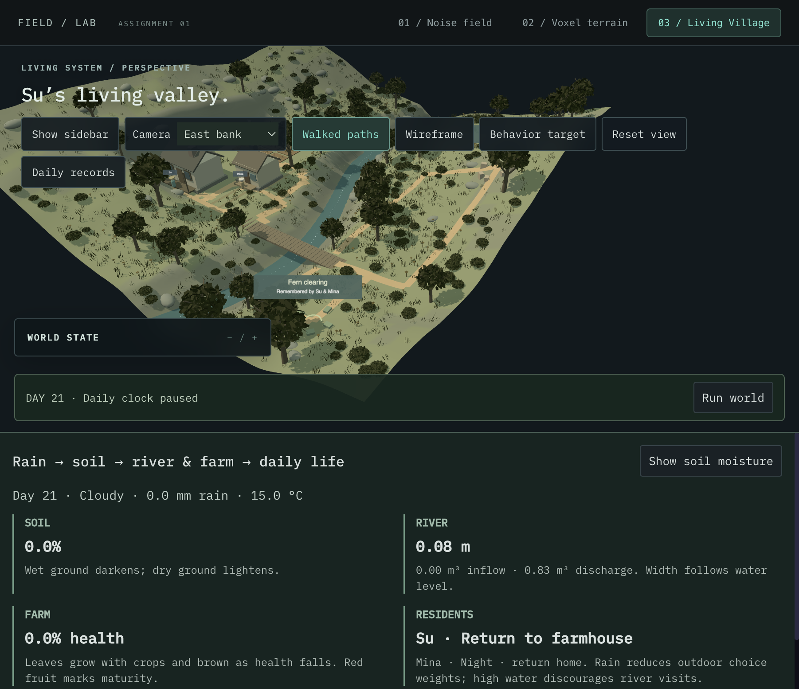

# Beyond the bridge — exploration and traces

Implemented November 2026. The question is how a place becomes familiar through repeated daily use. This phase connects movement to visible traces and future choices. This document records the exploration checkpoint; [Phase 5](PHASE5_DEVELOPMENT.md) adds physical map expansion, a shop, storm damage and bridge closures.

## What runs

Two fixed landmarks, Fern clearing and Old stone garden, occupy clear areas on the eastern bank of the existing 40 × 40 m valley. Their locations are authored; the daily decisions, routes, memories and accumulated paths are computed. They are not additional generated maps.

- **Travel conditions:** no expeditions at rainfall ≥8 mm/day, river level >1.2 m, temperature below 5°C or above 30°C, or curiosity 0. These gate daily plans; changing a slider does not cancel a walk already underway.
- **Su:** visits the farm first. On suitable days, curiosity controls an expedition chance, reduced when at least five crops are ripe. Rain ≥5 mm/day keeps Su home. Otherwise the routine ends at home.
- **Mina:** exploration participates in weighted day-part decisions, at most once a day. Energy below 45% prevents an expedition. Travel distance, novelty, familiarity and social need influence selection.
- **Destinations:** unseen eastern places receive a novelty multiplier of 2.4. Familiarity can multiply future choice weights by at most 1.35. Mina’s memory toggle disables her familiarity feedback while preserving her records; Su’s feedback remains enabled.
- **Actual arrivals:** update first day, visit count and familiarity; a failed route or consecutive stay at one place does not count. First visits enter the discovery journal and change the scene label.
- **Actual footsteps:** each completed navigation segment adds 0.18 wear, capped at 1. Width and exposed-soil color increase with wear. Grass and flower rendering compresses nearby; trees are unaffected. Bridge crossings count, but timber receives no dirt trail.
- **Recovery:** segments unused on the preceding day retain 92% of their wear each new day. Grass appearance returns with fading wear, subject to the existing ecology state. This is a visual wear/recovery model, not a physical compaction simulation.
- **Time:** playback waits for both residents to finish. Movement speed changes observation time, not visit or trail totals. Live ecology and curiosity edits preserve memories and traces; explicit study/reset actions replace the world. Reload persistence is not implemented.

## Observe it

1. Open Living Village and choose **Start exploration study**. This deliberately replaces the run with a dry spring scenario and settled Mina, at 8× playback.
2. Choose **Expand world**, then **East bank**, **Follow Mina** or **Follow Su**. Orbit and zoom remain available. The viewport expands; the terrain bounds stay unchanged.
3. Observe actual bridge crossings and landmark labels. The sidebar records first arrivals and repeat visits; **Walked paths** toggles the trace layer.
4. Set curiosity to 0. Finish the current routine and advance another day: new plans stay local. Set it higher to make expeditions more likely.
5. Increase rain probability and maximum rain, then watch subsequent days. Recorded rain, rather than slider position alone, determines travel restrictions. The dry preset eventually produces drought; live ecology edits can change that trajectory.

## Evidence and limits

Automated tests cover reachable bridge routes, discoveries by both residents over 16 dry days, severe-weather deferral, no credit for failed routes or repeated stays, trail recovery, and identical memories/trails at movement steps of 0.1 and 0.8 seconds. UI tests cover waiting for Su before advancing and preserving the current day when changing camera or expanding the viewport. The full suite passes 65 tests.

In browser observation of the seed-42 dry study: Mina first reached Fern clearing on day 1 and Old stone garden on day 4; Su first reached Old stone garden on day 2 and Fern clearing on day 6. These are observations of that preset, not guaranteed discovery dates for other parameters.

The dry study at day 21. Continued lack of rain has also dried the soil and damaged crops; exploration does not reset those ecological consequences.

At this checkpoint, bridge damage, windthrow, shop construction and extra regions were deferred; they are now implemented in Phase 5. General floodplain obstacles, seed dispersal and plant colonization remain open. Trail wear still does not affect route cost or soil budgets.
