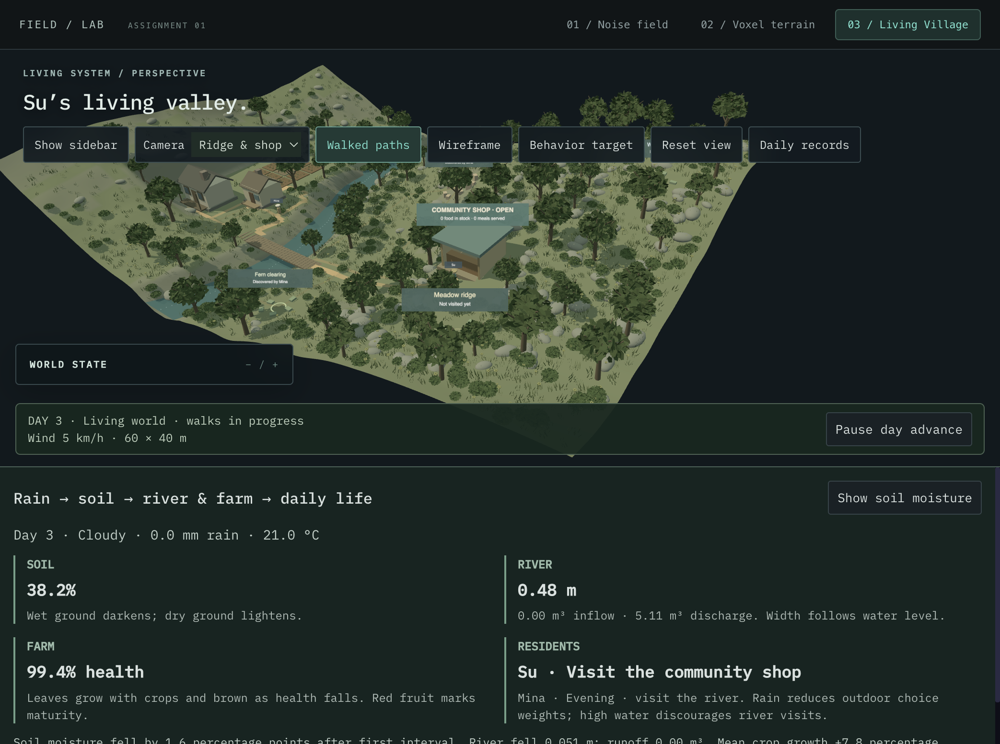
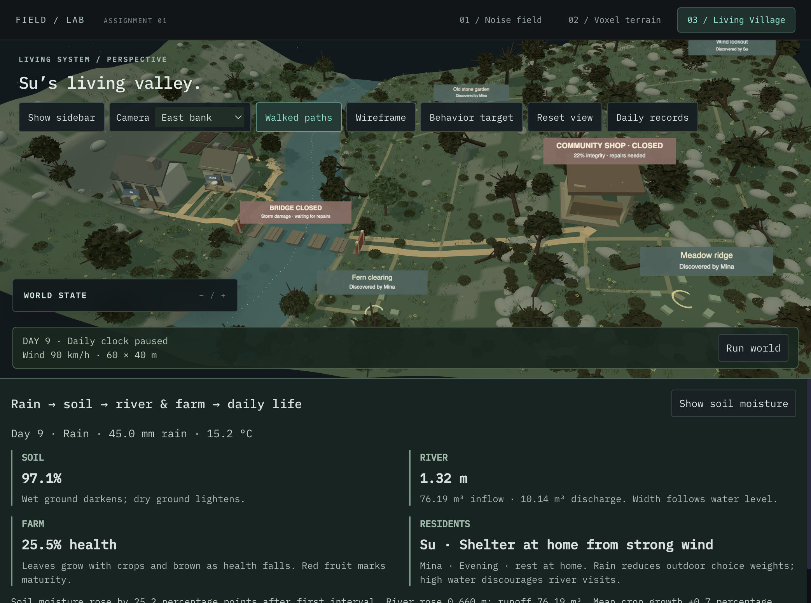

# Build, weather, recover

The design question extends “a place becomes home through use”: **what happens to shared daily life when an environmental event breaks its connections?** A shop creates a destination and a shared resource. Storms make access conditional. Repair requires residents to go somewhere and act, and the landscape retains evidence afterward.

## Current implementation

### Continuous land, preserved history

Opening the eastern ridge appends a 20 × 40 m strip to the original 40 × 40 m valley. The new mesh continues the terrain function into a gentler eastern ridge. Its 512 ecological cells retain the original 1.25 m cell width; the first 1,024 cells and all original vegetation indices remain unchanged. New soil starts at 55% capacity and vegetation at 80% health/biomass; this is an explicit initial condition for newly introduced land. Added sites use a separate seeded stream. The new region contributes water runoff to the existing reservoir.

Meadow ridge and Wind lookout are authored landmarks within that land. Su and Mina can choose them through the existing exploration rules and actually walk there. The site locations are fixed; terrain sampling, vegetation distribution, daily choices and path history are procedural. Expansion is a user action, not automatic growth. Opening the region does not change the current day, RNG, old soil, crops, residents, memories or history.

### Shop: commission → work visits → trade

The community shop occupies a reserved eastern site. Commissioning shows a foundation and reserves its footprint in navigation. On subsequent dry, calm days, Su replaces exploration with a work visit. Two completed visits on separate days produce the frame and finished shop. Unfinished or unreachable journeys do not advance construction.

An open shop receives up to four food per day from the village harvest reserve, capped at twelve in stock. The transfer retains four in reserve before daily resident consumption. No food is created by the shop. Su visits on every third open day when no repair/construction task takes priority; Mina considers the shop in her weighted choices, at most once per day. A completed customer arrival consumes one food, adds up to 0.18 energy and reduces social need by 0.15. Empty shelves still permit social visits. Construction and repair visits are counted in the visit total but do not consume meals. Harvest and collective replanting remain user actions.

Construction and repairs currently require visits rather than currency, timber or a labor-duration model. The shop is a community food store, with no prices or cash economy.

### Storms: transient weather, persistent consequences

Storm probability defaults to zero for controlled comparison. A separate seed/day stream chooses natural storm events and wind intensity. Natural storm peaks are 75–100% of the selected maximum; **Queue one storm** uses the selected peak exactly on the next day. Both bring at least 45 mm of rain. Existing walks finish before normal playback advances. Calm days have mild wind from a separate stream.

Damage severity is `clamp((windKph - 40) / 55, 0, 1)`. Terrain elevation affects plant exposure. Seeded tree/shrub selection produces lasting damage, with some trees falling at high severity. Wind also reduces crop health/growth and structural integrity. Daily records contain the resulting post-damage crop values. This is an illustrative design model: individual structures do not have engineered resistance, and rainfall alone does not erode buildings.

At 55 km/h residents shelter. Bridge integrity below 55%, or water level above 1.2 m, closes crossing routes. Shop trade requires completed construction, at least 55% integrity, and wind below 55 km/h. Navigation cache keys include expansion, bridge closure and shop footprint; an existing resident route is rechecked when these conditions change.

### Recovery and repair

On days with wind below 40 km/h and rain below 5 mm, Su prioritizes the bridge if damaged and water has receded to at most 1.2 m. A completed work arrival restores 35 integrity points. Shop work follows once access allows it; each repair visit restores 40 points, at most once per day. The bridge and shop can reopen at 55% before restoration reaches 100%.

Damaged plant sites recover by 3.5 points on calm days when local soil moisture is between 20% and 85%. Fallen trunks remain fallen; after enough suitable days, small saplings appear nearby and increase in size. These saplings visualize recovery state; they are not new independently simulated vegetation populations. Fallen trees do not obstruct routes, and seed transport, competition and general floodplain pathfinding are not implemented.

## Observe the causal chain

1. For a fresh controlled run, choose **Start exploration study** first; that action explicitly replaces the run and settles Mina. To retain an existing run, skip this step.
2. Choose **Open eastern ridge**, then **Commission shop**. Use **Run world** or **Play 30 days**. The shop frame appears after Su's first completed work visit; the second completes it.
3. Choose **View ridge & shop** or **Follow Su**. Harvest ripe crops to supply the shop; no stock appears until there is a real surplus.
4. Choose **Queue one storm** with peak wind around 90 km/h. On the next day, inspect fallen trees, broken planks, barriers, roof damage, closed labels, soil moisture and the action journal.
5. Keep storm probability at zero to observe repair. Playback completes actual work journeys before advancing another day. Plant recovery also requires suitable moisture, so prolonged drought delays it.

Live controls, expansion and commissioning preserve the ongoing run. Explicit reset/study actions replace it. Page reload persistence is still not implemented. **Expand world** changes viewport width; **Open eastern ridge** changes the physical world. Instant 30-day ecological skipping is disabled for expanded worlds and queued storms so that work and recovery can be watched through playback.

## Evidence

- Automated coverage verifies preservation of original cells/sites, actual reachability in new land, construction from completed visits, stock conservation, meals applied on arrival, deterministic damage, navigation closure, interrupted routes, shelter, repairs/reopening, recovery, and UI controls preserving the current day.
- Browser observation: in the seed-42 dry prepared world, Su completed the frame on day 1 and opened the shop on day 2. Mina reached Meadow ridge and Su reached Wind lookout on day 4. A queued 90 km/h storm on day 5 damaged 466 plant sites and felled 31 trees; Su repaired the bridge on days 6 and 7, then restored the shop to 81% on day 8. These are one run's observations, not guaranteed dates/counts for different actions or seeds.

The first screenshot shows an empty store: construction alone supplies no food. The second captures a second storm before shop repair was complete, demonstrating cumulative damage.
