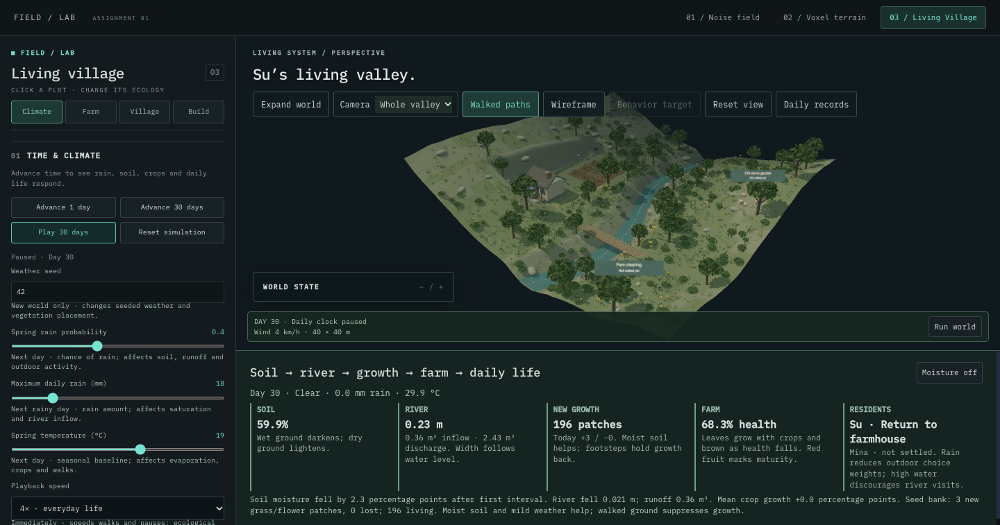

# Phase 6 — seed-bank growth

## Question

Can the same rain → soil → daily movement chain change *where new vegetation appears* over time? The earlier ecology changed the health and color of plants placed at world creation, but no new patches could establish. That made long-term environmental change hard to see.

## Current rule

The seeded landscape now contains invisible potential grass and flower sites. They use a separate random stream, so adding them does not move the existing plants. On each simulated day, after soil and storm effects resolve, each potential site reads its own cell's moisture, fertility and vegetation health, the day's temperature, and wear from **completed footsteps**. Suitable unoccupied ground may germinate according to the live **Seed-bank germination chance** control. Established patches grow gradually; dry, saturated, cold or heavily walked ground can shrink and eventually lose them. Houses and the commissioned shop suppress establishment inside their footprints.

The scene draws each new patch at its accumulated size. The Land & water controls show the number of living new patches, while the cause-and-effect panel shows today's gains and losses and explains the conditions. The control affects the next day and preserves the current world, people and history. A setting of zero stops *new germination*; existing patches still respond to their environment.

## Try it

For a controlled comparison, start a fresh world with the same seed. Set spring rain probability to about 1, maximum rain to 3–5 mm and seed-bank germination chance to 0.3, then advance or play 20–30 days. Compare the new-growth count and visible flowers against an otherwise identical run at germination chance 0. A long dry run makes established patches decline. Once residents have completed walks, their worn routes inhibit nearby new growth.

## Evidence and limits

Tests compare a zero-rate and high-rate run under the same weather, confirm deterministic results without changing the weather RNG, show that drought removes patches, verify a live control edit preserves history, and test suppression at a walked seed-bank site. The production build also compiles.

In a browser observation with seed 42 and the default climate, the day-30 panel showed **196 living new patches**, including **3 established that day**. Pale yellow flower patches are visible across the ground. This is one run's result; weather and changed controls alter the count.

Potential sites are sampled once from the seed; this is a **latent seed-bank model**, not unrestricted seed dispersal, reproduction, competition or fully simulated succession. New grasses and flowers do not yet change route-finding or soil water demand. The daily world remains step-based rather than evolving in wall-clock time while paused.
